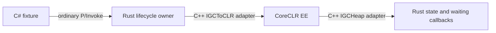

# 1. The suspension contract

[Mission overview](README.md) · [Next: the first empty cycle](02-empty-cycle.md)

Native diagnostics need a period in which managed threads cannot change the
graph being inspected. This chapter explains the CoreCLR contract for creating
that period and the obligations it places on ZeroGC.

A mutator is a thread running managed code that can change object fields.
In cooperative mode, the runtime must coordinate with that thread to stop it.
In preemptive mode, the runtime can proceed without waiting for the thread's
native work to finish; native access to managed references still has rules.

## The managed baseline

Mission 07 supplies managed `Node` graphs, explicit fixture roots, and an
independent oracle for expected edges and reachable labels. C# reads the `Next`
fields; the Rust model checks the same scenarios as logical graphs. Neither
path reads native object memory.

Run the baseline from the repository root:

```powershell
python scripts/graph_fixtures.py
```

The recorded run passed all six model scenarios and all twelve stock-GC/ZeroGC
processes. The runner checks the graph against the oracle, requires successful
process exit, verifies which GC loaded, and checks these ordered records:

```text
dotnet: fixture '<scenario>' constructed
dotnet: fixture '<scenario>' observation declared-only raw-handoff=unsupported
dotnet: graph '<scenario>' <edges> <roots> <live labels>
dotnet: fixture '<scenario>' continuation
```

Raw logs are under `out/graph-fixtures/` and are replaced on rerun. A
`--stock-only` run helps isolate failures but does not cover ZeroGC.

The fixture retains all nodes with `GC.KeepAlive`, including disconnected ones.
Its explicit roots describe the test graph, not the runtime's complete root
set. Keeping objects alive does not establish stable addresses or prevent
another thread from changing their fields.

The [sample](../../samples/GraphFixtures/Program.cs),
[fixture contract](../../samples/GraphFixtures/README.md), and
[runner](../../scripts/graph_fixtures.py) define this baseline.

## The pinned runtime

The contract below comes from the repository's pinned CoreCLR sources.

| Component | Pin |
| --- | --- |
| Target | Windows x64, workstation GC |
| .NET SDK | `10.0.400`, [global.json](../../global.json) |
| Managed runtime | `10.0.11`, [GraphFixtures.csproj](../../samples/GraphFixtures/GraphFixtures.csproj) |
| Runtime source | `79d0c463f1b55624c874a11585f7e47731e8d675`, `external/dotnet-runtime` |
| GC interface | Major 5, minor 5 |
| EE interface | Major 4 |

The sample disables runtime roll-forward. If a pin changes, recheck the contract
against the new sources. Use `git submodule status -- external/dotnet-runtime`,
`dotnet --version`, and `dotnet --list-runtimes` to check the local environment.

## Calls in both directions

`IGCToCLR` lets the GC ask the execution engine (EE) to suspend or restart managed
execution. `IGCHeap` lets the EE call back into the GC for state changes, waiting,
and thread cleanup. Supporting suspension requires both directions.



The diagnostic pair is `SuspendEE(SUSPEND_FOR_GC_PREP)` followed by
`RestartEE(false)`. Both methods return `void`. The pinned GC uses this pair
without claiming a completed collection; ZeroGC therefore keeps its collection
count at zero during diagnostics.

### What suspension guarantees

`SuspendEE` locks ThreadStore, the runtime's managed-thread registry, updates GC
state, and prevents other managed threads from continuing cooperative execution.
It also traps their return from native code. The lock remains held until restart.

After `SuspendEE` returns, the owner can perform its bounded native operation.
Operating-system threads running native code may still execute: suspension
coordinates managed execution rather than freezing every thread.

`RestartEE` clears the GC-in-progress flag, prepares managed threads to resume,
removes the return trap, signals waiters, and releases ThreadStore. Managed work
may resume before `RestartEE` returns. All borrowed object access must therefore
end **before calling restart**.

### Who owns the pair

The fixture uses ordinary GC-transitioning P/Invoke. The same OS thread enters
native code, suspends the EE, performs the operation, restarts the EE, and
returns to C#. A private stack-bound guard keeps ownership within that call.

In the pinned JIT, the ordinary P/Invoke path enters preemptive mode before the
native call and restores cooperative mode afterward, checking the return trap.
`SuspendAllThreads` excludes the requesting thread; `LockThreadStore` handles
the mode transitions needed to acquire its lock. These source facts support
the selected caller. The runtime probe in chapter 2 confirms the empty cycle;
no generated-code or disassembly probe has been run.

The entry must not use `SuppressGCTransition`, hold a managed monitor or native
lock needed by suspension, or call managed code inside the stopped interval.
A lock held by a stopped mutator cannot be released until restart, so waiting
for it from the suspension owner would deadlock. ThreadStore ownership belongs
to the EE and must not be managed independently by the diagnostic code.

## Required GC callbacks

Suspension state and collection state are distinct. The EE sets GC-in-progress
even for an empty diagnostic cycle. Reporting a constant `false` would break
the thread-transition contract.

| Callback | Required behavior |
| --- | --- |
| `GetGcCount` | Report the collection count; diagnostics complete no collection |
| `SetGCInProgress`, `IsGCInProgressHelper` | Maintain and report EE-visible progress |
| `ResetWaitForGCEvent` | Make the completion condition unsignaled before return trapping |
| `SetSuspensionPending` | Balance pending-suspension state as traps are installed and removed |
| `WaitUntilGCComplete` | Wait for completion when required and return `S_OK` |
| `SetWaitForGCEvent` | Wake all waiters and preserve a signal that precedes a wait |
| `FixAllocContext` | Handle the allocator's actual context state during thread cleanup |

`Thread::RareDisablePreemptiveGC` treats a wait result other than `S_OK` as
fatal. `Thread::CooperativeCleanup` calls `FixAllocContext` at thread exit.
These obligations remain even if a single-mutator probe never reaches them.
Chapter 2 describes their current implementation.

Allocation-context enumeration and heap-association queries remain unsupported.
An EE suspension alone does not require a root scan or retire allocation tails
on behalf of the collector.

## Reference lifetime and failure boundaries

The empty cycle passes no object addresses. Later handle handoff must follow
this order:

1. C# creates normal GC handles and passes opaque tokens through P/Invoke.
2. After suspension returns, native code resolves supported handles and borrows
   references for the diagnostic operation.
3. All borrowed access ends before the single restart attempt.
4. After successful restart, native code returns copied results and C# releases
   handles in `finally`.

A normal handle roots an object; its token is not an object address.
`ObjectFromHandle` is an internal runtime helper, not an exported API available
to the shim. A supported resolution mechanism is still required before enabling
raw handoff.

The exactly-once rule counts the owner's restart attempt after its public
suspend call returns successfully. CoreCLR may restart and retry internally.
Because the public methods return `void`, injected callback errors in native
tests do not model a recoverable CoreCLR error result. An exception after
partial runtime changes cannot be treated as an ordinary pre-suspend failure.

A failed restart does not establish managed continuation. A successful empty
cycle establishes no object layout, root coverage, liveness, or reclamation
safety.

## Source map

| Source | Relevant contract |
| --- | --- |
| [gcinterface.ee.h](../../external/dotnet-runtime/src/coreclr/gc/gcinterface.ee.h), [gcinterface.h](../../external/dotnet-runtime/src/coreclr/gc/gcinterface.h) | Interface versions, suspend reasons, method signatures |
| [gcenv.ee.cpp](../../external/dotnet-runtime/src/coreclr/vm/gcenv.ee.cpp) | `GCToEEInterface::SuspendEE` and `RestartEE` wrappers |
| [threadsuspend.cpp](../../external/dotnet-runtime/src/coreclr/vm/threadsuspend.cpp) | ThreadStore ownership, suspension, return trapping, restart, and waiting |
| [lower.cpp](../../external/dotnet-runtime/src/coreclr/jit/lower.cpp) | `LowerNonvirtPinvokeCall`, `InsertPInvokeCallProlog`, `InsertPInvokeCallEpilog` |
| [gc.cpp](../../external/dotnet-runtime/src/coreclr/gc/gc.cpp), [gcee.cpp](../../external/dotnet-runtime/src/coreclr/gc/gcee.cpp) | GC-side suspend/restart pair, progress and event semantics, allocation-context retirement |
| [threads.cpp](../../external/dotnet-runtime/src/coreclr/vm/threads.cpp) | `Thread::CooperativeCleanup` |
| [gchandleutilities.h](../../external/dotnet-runtime/src/coreclr/vm/gchandleutilities.h) | Internal handle resolution |
