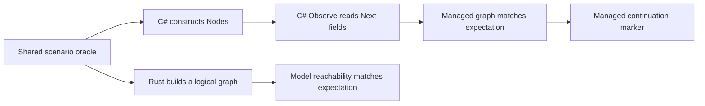
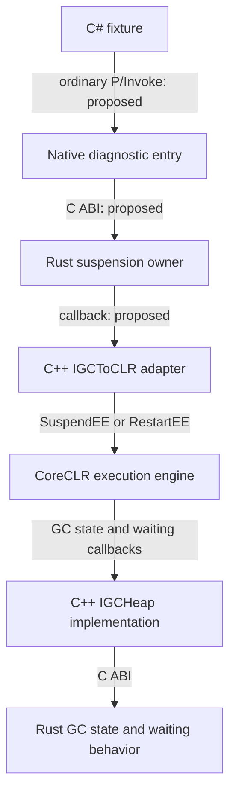
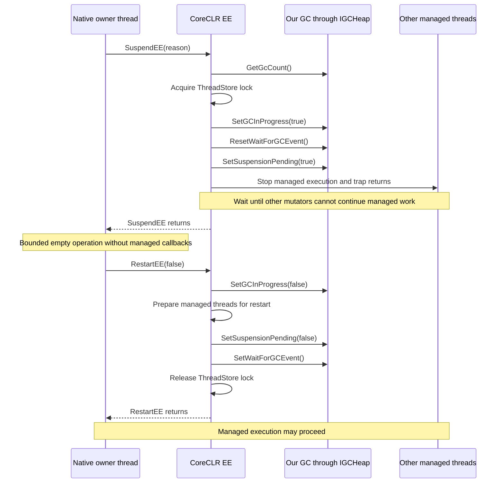
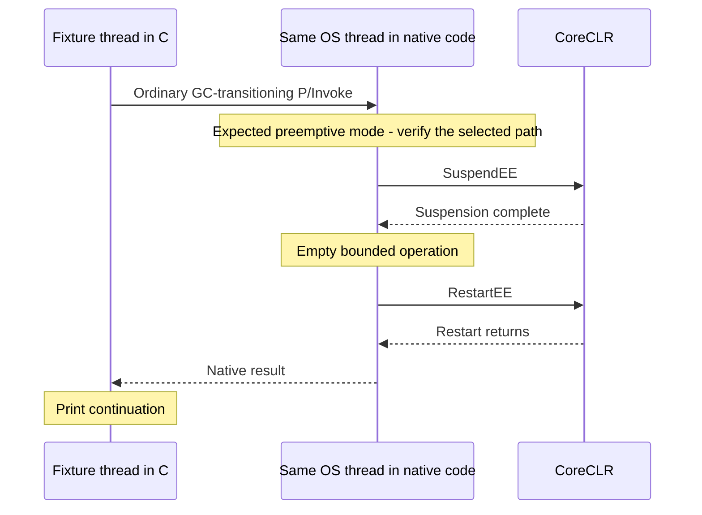
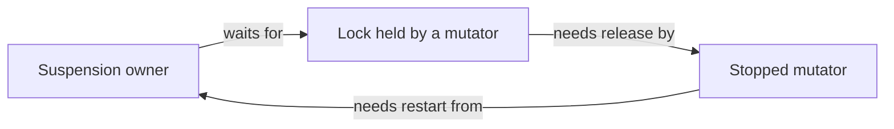
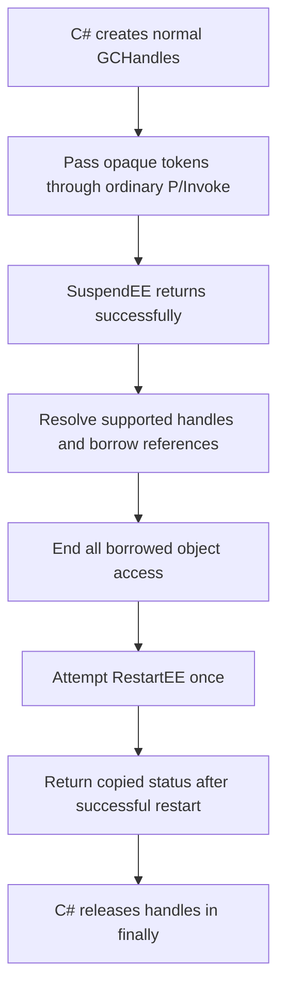

# Step 1: establish the starting point and suspension contract

Parent: [Mission 08 plan](README.md).

Status: source inspection and experiment plan, written on 2026-10-19.
The baseline commands and proposed runtime experiments below were not executed
as part of writing this document. A source fact is not a runtime test result.

## 1. Where we are

Mission 07 gives us a small managed graph with independently declared expected
edges, explicit fixture roots, and expected reachable labels. The same scenarios
also run through the Rust graph model.

The managed sample constructs real `Node` objects and reads their `Next` fields
in C#. Its `Observe` method is a convenient place to add a future diagnostic
call, but it currently makes no native diagnostic call.



Both paths check graph semantics. Neither demonstrates native inspection of a
stopped managed heap.

Current evidence in the code:

| What exists | What it tells us | What it does not establish |
| --- | --- | --- |
| Hand-written `scenarios.txt` | The expected graph is independent of native addresses | That native code can read those objects |
| No-inline C# `Observe` | There is a visible managed control point | A P/Invoke transition or a stopped interval |
| `constructed` and `continuation` markers | Construction and later managed execution are observable | That a suspension happened between them |
| `GC.KeepAlive(nodes)` and `GC.KeepAlive(roots)` | Fixture objects remain reachable through their intended use | Stable addresses or unchanged fields |
| ZeroGC slow allocation | Bounded managed samples can allocate without collection | Working suspension callbacks or thread-exit handling |
| `IGcToClr` callback table | Rust can ask the runtime to update the write barrier | Rust can call `SuspendEE` or `RestartEE` |

Read [GraphFixtures/Program.cs](../../samples/GraphFixtures/Program.cs),
[its README](../../samples/GraphFixtures/README.md), and
[the fixture runner](../../scripts/graph_fixtures.py) first.

The current observation marker is deliberately honest:

```text
fixture <scenario> observation declared-only raw-handoff=unsupported
```

Keep that statement true until a separate native path is implemented and tested.

## 2. What we want to understand

The immediate goal is to answer this question:

> Can a permitted native caller stop managed execution and restart it on the
> same thread, without a deadlock or an unsupported GC callback?

Answer these smaller questions before deciding the implementation:

1. What changes when C# enters native code through ordinary P/Invoke?
2. May that same thread call the pinned runtime's suspend/restart interface?
3. When does the runtime consider suspension complete?
4. Which locks, flags, and waiting mechanisms stay active until restart?
5. Which calls come back from the runtime into our GC during that interval?
6. Which reason and restart argument describe diagnostics without a collection?
7. What can an experiment prove, and which conclusions need later tests?

This step produces an evidence-backed contract and a small experiment plan.
It does not need a heap reader, real collection, or a new allocation strategy.

## 3. Use a small vocabulary

| Term | Plain meaning here |
| --- | --- |
| EE | The execution engine: the CoreCLR part that runs and coordinates managed threads |
| Mutator | A thread running managed code that can change object fields |
| Cooperative mode | A managed-thread mode in which the runtime must coordinate the thread before it can inspect managed state safely |
| Preemptive mode | A mode in which the runtime can proceed with suspension without waiting for that thread to finish its native work; the native code must obey its managed-reference access rules |
| Suspension owner | The thread and code responsible for the matching suspend/restart pair |
| Stopped window | The interval after `SuspendEE` returns and before restart begins |
| ThreadStore | Runtime bookkeeping for managed threads, protected by a runtime lock |
| Handle token | An opaque value identifying a rooted reference, not an object address |

"Stopped" does not mean every operating-system thread is frozen. Native code
may keep running. The useful guarantee is that managed execution cannot keep
changing the graph while our permitted diagnostic operation runs.

## 4. Confirm the exact runtime before reading its contract

The repository currently pins:

| Component | Pin and source |
| --- | --- |
| Target | Windows x64, workstation GC |
| .NET SDK | `10.0.400`, [global.json](../../global.json) |
| Managed runtime | `10.0.11`, [GraphFixtures.csproj](../../samples/GraphFixtures/GraphFixtures.csproj) |
| Runtime source | `79d0c463f1b55624c874a11585f7e47731e8d675`, submodule `external/dotnet-runtime` |
| GC interface | Major 5, minor 5, pinned `gcinterface.h` |
| EE interface | Major 4, pinned `gcinterface.h` |

From the repository root, record:

```powershell
git status --short
git submodule status -- external/dotnet-runtime
dotnet --version
dotnet --list-runtimes
```

The submodule commit was checked while writing this document and matches the
pin above. Installed SDK/runtime availability and actual sample execution remain
to be checked. `dotnet --info` alone does not establish which runtime a sample
loads. Keep the sample's runtime roll-forward disabled.

Do not change the runtime version to make an experiment pass. If the pin changes
intentionally, revisit the contract instead of assuming it is unchanged.

## 5. Reproduce the managed baseline first

Run the existing complete Windows checkpoint:

```powershell
python scripts/graph_fixtures.py
```

It checks the Rust model, builds the sample and shim, then runs all six scenarios
under stock workstation GC and ZeroGC. It saves per-process output under
`out/graph-fixtures/`.

Expected scenario coverage: chain, cycle, disconnected components, duplicate
roots, null fields, and no explicit roots.

For each supported run, require the ordered records:

```text
fixture <scenario> constructed
fixture <scenario> observation declared-only raw-handoff=unsupported
graph <scenario> <edges> <roots> <live labels>
fixture <scenario> continuation
```

The graph record must match the oracle, the process must exit successfully, and
ZeroGC must show the expected custom-GC initialization evidence. The existing
runner performs these checks.

If this fails, record whether it is an environment, build, model, stock-GC, or
ZeroGC failure. Restore this checkpoint before attributing a failure to the new
suspension work. A `--stock-only` run is useful for isolation, but does not pass
the complete Windows checkpoint.

An empty explicit fixture root set is not an empty runtime root set. The fixture
deliberately retains all nodes, including disconnected ones.

## 6. Read the call chain in both directions

There are two different interfaces:

- `IGCToCLR`: our GC asks the runtime to do something, such as suspend execution.
- `IGCHeap`: the runtime asks our GC for behavior, such as setting an in-progress
  flag or waking threads that are waiting for restart.

Adding a call in the first direction creates obligations in the second.



The native diagnostic entry and suspend/restart callbacks in this diagram are
planned additions. They are absent from the current fixture and callback table.

### Reading route

| Read | Find | Question to answer |
| --- | --- | --- |
| [gcinterface.ee.h](../../external/dotnet-runtime/src/coreclr/gc/gcinterface.ee.h) | `SuspendEE`, `RestartEE` | What are the actual signatures? |
| [gcinterface.h](../../external/dotnet-runtime/src/coreclr/gc/gcinterface.h) | `SUSPEND_REASON`, `IGCHeap` methods | Which reasons and reverse callbacks exist? |
| [gcenv.ee.cpp](../../external/dotnet-runtime/src/coreclr/vm/gcenv.ee.cpp) | `GCToEEInterface::SuspendEE`, `RestartEE` | How does the EE implement the interface? |
| [threadsuspend.cpp](../../external/dotnet-runtime/src/coreclr/vm/threadsuspend.cpp) | `LockThreadStore`, `SuspendEE`, `SuspendAllThreads`, `RestartEE`, `ResumeAllThreads` | Who owns locks, flags, and wakeups? |
| [gc.cpp](../../external/dotnet-runtime/src/coreclr/gc/gc.cpp) | `gc_heap::suspend_EE`, `gc_heap::restart_EE` | Is there a pinned example of stopping without claiming a completed collection? |
| [shim.cpp](../../native-shim/src/shim.cpp) | `RustGCHeap`, `Initialize`, `ABORTING_OVERRIDE` | Which required operations are currently missing? |
| [runtime.rs](../../crates/gc-rust/src/runtime.rs) | `IGcToClr`, `GcToClr` | What can Rust currently request? |
| [gc_heap.rs](../../crates/gc-rust/src/gc_heap.rs) | `rust_gc_is_gc_in_progress_helper`, `rust_gc_alloc` | Which old ZeroGC assumptions must change? |

For the managed transition, also inspect ordinary P/Invoke generation and the
`SuppressGCTransition` branches in
[dllimport.cpp](../../external/dotnet-runtime/src/coreclr/vm/dllimport.cpp).
Follow the selected Windows x64 stub/JIT path as needed; do not assume every
declaration uses the same generated stub.

### Facts already established by source inspection

1. Both public interface methods return `void`. Neither offers a normal
   `HRESULT` failure result.
2. The EE wrapper accepts `SUSPEND_FOR_GC` and `SUSPEND_FOR_GC_PREP`.
3. `SuspendEE` acquires the ThreadStore lock and keeps it until restart.
4. `SuspendAllThreads` skips the current managed thread, waits for other threads
   to leave cooperative execution, and prevents their return to managed code.
5. The runtime calls GC state and event methods during this process.
6. `RestartEE` clears the in-progress flag, prepares threads to resume, removes
   the return trap, signals waiting threads, and releases the ThreadStore lock.
7. The pinned GC contains a pair using `SUSPEND_FOR_GC_PREP` and
   `RestartEE(FALSE)`. This is evidence for the diagnostic choice to investigate.

### Simplified normal sequence

This diagram omits debugger/profiler hooks, platform-specific details, and
runtime-internal retries. It shows the ordering relevant to our GC obligations.



Managed threads can start progressing during restart, before `RestartEE`
returns. End borrowed object access before calling restart, not after it returns.

### Why the old in-progress answer is insufficient

`rust_gc_is_gc_in_progress_helper` currently always returns `false`, because
ZeroGC has never collected. The EE sets the in-progress flag even for an EE
suspension that is not an actual collection. Once we support that suspension,
the old answer no longer describes reality.

Keep three concepts separate: an active suspension request, the EE's GC state,
and the number of completed collections. A diagnostic cycle does not justify
incrementing the collection count.

## 7. Decide which thread to try first

Proposed first candidate: the same OS thread enters ordinary P/Invoke, calls
suspend, performs the empty operation, calls restart, and returns to C#.



Why start here:

- The call is synchronous, so the caller and its inputs have a simple lifetime.
- `SuspendAllThreads` explicitly excludes the current thread from its target
  loop; it does not wait for its own suspension request to finish.
- ThreadStore ownership extends across the pair, so keeping both calls on the
  same thread avoids introducing a cross-thread lock handoff.
- `LockThreadStore` handles GC-mode transitions around acquiring its lock.
  Its comments explain why blocking in cooperative mode can prevent another
  suspension from completing.

These source observations support a candidate; they do not replace a successful
runtime experiment. Confirm the actual P/Invoke transition and any additional
reference-access rules before claiming the path is supported.

Do not use `SuppressGCTransition`. Also do not manually change an internal
Thread field, hold a managed monitor across the request, or call managed code
while the runtime is suspended.

A dedicated native worker is a fallback only if a specific contract or failed
experiment rules out the simpler path. It adds thread setup, request transport,
waiting rules, and shutdown obligations. The fact that the callback table is
`Send`/`Sync` in Rust does not permit every callback on every thread.

### A deadlock to look for



This can involve our own mutexes or logging locks, even when no C# monitor is
involved. Before a real suspend call, list the resources held by the owner and
those acquired by the operation and reverse callbacks. Remove any cycle.
The intentionally held ThreadStore lock is managed by the EE contract; do not
attempt to acquire or release it independently.

## 8. Inventory required callbacks before a real probe

Do not add suspend/restart wrappers and immediately call them against the
current shim. The normal source path already reaches aborting methods.

| Callback | Source evidence | Current implementation | Follow-up obligation |
| --- | --- | --- | --- |
| `GetGcCount` | `ThreadSuspend::SuspendEE` reads it | Aborting override | Supply the truthful collection count |
| `SetGCInProgress` | Suspend sets true; restart sets false | Aborting override | Maintain EE-visible state |
| `IsGCInProgressHelper` | Thread transition logic queries GC state | Always false in Rust | Define the meaning of both `bConsiderGCStart` values |
| `ResetWaitForGCEvent` | `SuspendAllThreads` resets before trapping returns | Aborting override | Establish an unsignaled wait condition |
| `SetSuspensionPending` | ThreadStore sets/unsets its return trap | Aborting override | Maintain pending-suspension state |
| `WaitUntilGCComplete` | A thread entering cooperative mode may wait | Aborting override | Actually wait and report the appropriate status |
| `SetWaitForGCEvent` | `ResumeAllThreads` wakes waiters | Aborting override | Wake all relevant waiters without a lost notification |
| `FixAllocContext` | Thread cleanup in `threads.cpp` calls it | Aborting override | Support the allocator's actual context invariant and thread exit |

The inventory is not a promise that every callback occurs in every run. A
single-thread probe may never exercise the waiting path. Source requirements
must not disappear just because a small fixture did not trigger them.

Treat `IsThreadUsingAllocationContextHeap` and `GcEnumAllocContexts` separately:
follow their callers and add them if the chosen path requires them. The basic
suspend wrapper does not by itself establish a need for root scanning or a
general allocation-context enumeration bridge. `FixAllocContext` at thread exit
is a distinct obligation.

Do not replace these methods with unconditional success or empty stubs. The
minimal implementation may rely on a proved empty allocation-context invariant;
it must detect unsupported state instead of discarding an active allocation tail.

## 9. What to try, in order

Experiments A and B are the immediate work for step 1. Experiments C and D
describe the smallest later runtime probes. They require the lifecycle owner,
bridge, and correct callback semantics from subsequent plan steps.

| Experiment | Change | Expected observation | If it fails |
| --- | --- | --- | --- |
| A: existing checkpoint | None | All six model/stock/ZeroGC fixtures pass | Isolate the existing failure first |
| B: native round trip | Add a bounded status-only P/Invoke probe later; no suspension and no handles | Native entry and return occur on one OS thread, followed by managed continuation | Resolve loading, export, ABI, or transition issues before suspension |
| C: one empty stopped window | Add the owner, bridge, and required callbacks before enabling the probe | Suspend returns, one restart attempt returns, then continuation | Classify missing callback, bad state, hang, or restart failure |
| D: one additional mutator | Add one bounded worker and confirm its managed progress | Worker makes progress before and after the stopped interval and exits cleanly | Inspect wait/event semantics and thread-exit callbacks |

Do not treat B as proof of suspension, or C as proof that another mutator was
stopped. D is the first probe here that can exercise another active mutator.
Repeated cycles and full fault injection remain later Mission 08 checkpoints.

For B, return fixed-size native status and thread-identity observations. Keep
OS thread IDs local to experiment logs; do not commit machine-specific traces.
If a debugger is needed to inspect the transition mode, investigate that as a
separate probe and repeat the normal run without an attached debugger.

For C and D:

1. Start a fresh process using the pinned custom GC and workstation mode.
2. Prepare buffers and any inputs before suspension.
3. Record bounded numeric phase events in preallocated native storage.
4. Call suspend and restart on the selected owner thread.
5. Format and print the observations only after restart returns.
6. Require a successful exit and managed continuation.

Use an external process timeout. The existing runner helper uses a 30-second
scenario timeout. A timeout is a failed experiment, not a recovered suspension;
do not attempt to "fix" a hung process by calling restart from another thread.
Successful reports should contain the ordered phases below. A hard crash may
prevent buffered output from being printed; use its exit status and debugger
evidence to investigate rather than requiring unsafe in-window logging.

```text
managed: constructed
native: entered
native: suspend requested
native: suspend returned
native: empty operation completed
native: restart attempted
native: restart returned
native: returning status
managed: continuation
```

These are proposed event names, not output the current runner understands.
Add a separate probe mode or runner when implementing them, preserving the
existing declared-observation checkpoint.

For D, use a small managed counter with explicit synchronization for observations.
Require evidence that the worker was active before requesting suspension and
that it progresses after restart. If sampling during the stopped interval,
resolve the counter's storage and native read contract first. Two identical
samples alone do not prove suspension: the worker may simply not have run.

## 10. Keep the first probe free of object addresses

A status-only round trip and an empty suspension need no object pointer.
That keeps the thread/ABI question separate from the handle-resolution question.

The later fixture handoff still needs this lifetime:



This is the normal successful path. A failed restart must not be depicted or
reported as confirmed managed continuation.

`GC.KeepAlive` addresses lifetime, not immobility. A normal handle roots an object,
but its token is not an address. `ObjectFromHandle` in
[gchandleutilities.h](../../external/dotnet-runtime/src/coreclr/vm/gchandleutilities.h)
is an internal runtime helper, not an exported API we can assume the shim calls.
Proving the supported resolution mechanism is a later step, before enabling raw
handoff. Do not borrow a reference before suspension or retain one into restart.

## 11. Record uncertainty and failure honestly

Use the following distinctions in the engineering notes:

| Classification | Example |
| --- | --- |
| Source fact | `SuspendAllThreads` resets the GC wait event before installing the trap |
| Proposed choice | Use `SUSPEND_FOR_GC_PREP` and `RestartEE(false)` for the empty diagnostic |
| Measured result | A named probe completed one pair on the same OS thread and reached continuation |
| Open question | Whether the chosen transition requires another mode change before later reference access |
| Unsupported path | Raw handle resolution is not yet implemented or validated |

In particular:

- A fake EE adapter may return an injected suspend/restart error for tests.
  CoreCLR's public methods still return `void`.
- An unexpected exception after partial EE changes does not prove suspension
  never happened. Do not treat it as an ordinary recoverable pre-suspend failure.
- The pinned implementation may internally restart and retry suspension when a
  debugger leaves threads at unsafe places. Our exactly-once requirement counts
  the owner's matching restart attempt after its successful public suspend call,
  not every internal runtime restart call.
- An empty window proves no object layout, root coverage, liveness, or sweep
  eligibility. Passing this experiment cannot authorize reclamation.

## 12. Exit condition for step 1

Before calling this step complete, record:

- [ ] The full Mission 07 checkpoint command and its observed result.
- [ ] The SDK/runtime/source pins used for the observation.
- [ ] The selected caller thread and the evidence for its P/Invoke transition.
- [ ] The suspend/restart signatures, proposed reason, and restart argument.
- [ ] A source-linked account of ThreadStore lock ownership and return trapping.
- [ ] The required GC callback inventory, including waiting and thread cleanup.
- [ ] The first unsupported boundary in the current code, without claiming a
      runtime failure that has not actually been reproduced.
- [ ] The smallest next experiment and the prerequisites needed to run it.

Suggested observation record to fill in after execution:

```text
Command / scenario:
Runtime and source pin:
Result and exit status:
Ordered markers:
Local log location:
Source fact confirmed or assumption changed:
First failure or remaining question:
Smallest next action:
```

The next document should turn this contract into the lifecycle owner's states,
ownership rules, and fake-EE tests. It should not introduce object decoding.
