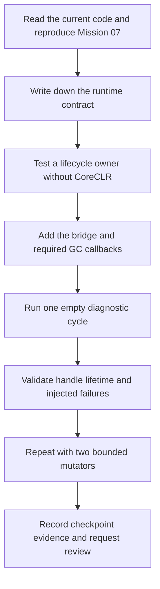

# Mission 08: suspension lifecycle

This folder develops the implementation plan for
[Mission 08](../../tasks/08-suspension-lifecycle.md). The mission establishes a
safe interval for native diagnostics: stop managed execution, perform bounded
work, and attempt restart exactly once after each successful suspension.

The first operation may be empty. Object decoding, root scanning, tracing,
reclamation, and allocation fast paths belong to later missions.

## Start here

Read [01: establish the starting point and suspension contract](01-observe-first.md).
It explains what exists, what we need to learn, which sources to read, and which
experiments to try before designing the implementation.

Status: planning and source inspection. The Mission 08 checkpoint has not been
run or passed as part of writing these documents. Existing mission checkboxes
remain unchanged.

## Working plan

Only step 1 currently has a detailed subdocument. Expand the other steps when
the preceding observations make their requirements concrete.

| Step | Question or outcome | Document |
| --- | --- | --- |
| 1 | What works today, and what does the pinned runtime require to stop and restart? | [Observe first](01-observe-first.md) |
| 2 | Who owns the cycle, rejects re-entry, and guarantees one restart attempt? | To be developed: lifecycle owner and tests |
| 3 | How do Rust and CoreCLR call each other through the C++ shim? | To be developed: minimal C ABI bridge |
| 4 | Which GC callbacks must work during suspension, waiting, and thread exit? | To be developed: runtime callback semantics |
| 5 | How does the managed fixture lend supported references to native diagnostics? | To be developed: handles and borrowed lifetimes |
| 6 | How do failures preserve cleanup and make restart failure observable? | To be developed: failure injection and reporting |
| 7 | Does managed execution continue with one mutator and repeated cycles with two? | To be developed: managed experiments |
| 8 | Which reproducible command proves the mission checkpoint? | To be developed: runner, regression checks, and evidence |

The diagram shows dependencies, not separate architectural layers to complete
in isolation. Bridge changes and required callbacks may need to land together
to produce the first meaningful runtime experiment.

## How to develop these documents

- Keep the mission checkpoint as the specification.
- Separate source facts, proposed choices, and measured observations.
- Link to repository files and name the relevant function; line numbers can move.
- Record a failed experiment and its smallest next action before expanding scope.
- Give each new document a narrow question, an experiment, and an exit condition.
- Keep local logs under `out/`; summarize portable findings in these documents.
- Do not mark a claim as validated just because it has a diagram or a proposed test.

See also the [mission workflow](../../tasks/README.md),
[review guide](../../tasks/REVIEW_GUIDE.md), and
[fixture handoff contract](../../samples/GraphFixtures/README.md#pinned-runtime-handoff-contract).
